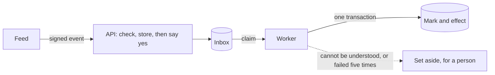

# webhook-platform

Part of the public portfolio of Luis Orozco. The other repositories stand at
[github.com/oplf-svg](https://github.com/oplf-svg).

Takes orders as signed webhooks and handles each one exactly once. The company behind it is made up: no shop, customer or
order in here is real.

## The claim

> No event is lost or handled twice, and forged ones are refused.

Every pull request has to show it again:

| | |
|---|---|
| [What it has to survive](docs/contract.md) | 18 things that can happen, and what must be true afterwards |
| [One at a time](crash/test_steps.py) | Each of them alone, most of them at a place that is known. A process is killed right after it stored an event, or stops in the middle of its transaction and goes on much later |
| [Everything at once](crash/test_storm.py) | Real processes are killed at every step and at any other moment, connections are cut and the database is killed, while events come twice, late, changed and forged. Every run is different |
| [Counted from outside](crash/count.py) | A program in another language knows what it sent. It reads the tables itself and compares |
| [Tests that can fail](crash/wrong.py) | More than 100 mistakes that are easy to make, one at a time. The tests have to notice each of them, and the list says which tests saw what |

The numbers of each run are on its summary page under [Actions](../../actions/workflows/ci.yml).

## How it works



- **Nothing is read before the signature is right.** The answer is the same for a wrong signature, a wrong time and a feed
  that does not exist. The shop comes from the secret that signed, never from the text.
- **Yes means stored.** The API answers only after the database has the event. If anything goes wrong in between, the feed
  sends it again, and the inbox knows it.
- **The mark and the effect are one transaction.** A crash repeats the work but never the effect.
- **A claim ends by itself.** A worker that comes back too late finds that its claim is gone, and changes nothing.
- **What fails does not block and does not disappear.** It is tried again, each time later, and is then set aside with its
  reason. Trouble with the database does not count against an event.
- **An event that kills its worker** is found out: what went down with it is taken up one at a time.

## What it does not do yet

- Exactly once holds for what is in this database. Calls to others need an id of their own, and come later.
- Events are kept for ever, and a person has no tool yet to look at what was set aside.
- It does not run anywhere but in tests. AWS, Azure and Google Cloud come later.

## Run the tests

They need the .NET SDK 10.0.4xx, Python 3.12 or newer, and Docker.

```bash
bash .github/scripts/tests.sh
```

## Who made this

Directed and approved by Luis Orozco. Code, tests and texts are written by Claude, an AI agent that proposes its changes under
an identity of its own. Why the inbox is built as it is stands in a [note](docs/decisions/0001-inbox.md), drafted by Claude and
confirmed by the owner.
